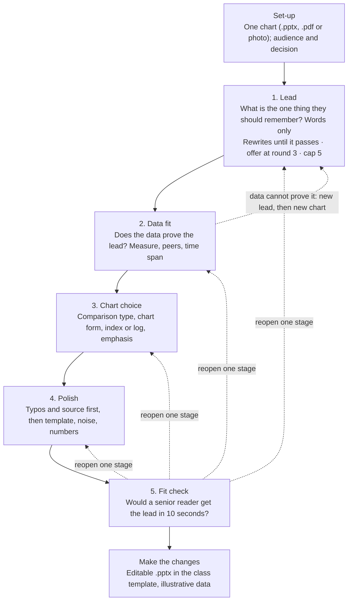

# PRD — Chart Makeover

14 Nov 2026 · @Chris Doran

## Summary

Chart Makeover coaches a student from one chart they have already made to a McKinsey-standard page, in five stages that each must pass before the next opens: **lead → data fit → chart choice → polish → lead–chart fit check**. The EM works in a chat thread, always giving issues first and then fixes. The student rewrites the lead and accepts or declines each fix. At the end, one button builds the improved chart as an editable PowerPoint slide in the class template, with illustrative data. No score.

The rules come from three pieces of class material: the Crafting Charts deck, the Writing Messages for Charts exercise and the Man City teaching note. Their example charts are used only to derive the rules and never appear in the app. Shared elements (persona, firm, records, architecture) are in the Common Module. By design, this tool departs from three Common Module principles: commit before feedback, no redraws, and limited attempts. The Common Module records the exceptions.

|   | 15 Oct version | This version |
| --- | --- | --- |
| Input | One-page PDF dummy chart | One existing chart: .pptx, .pdf or photo |
| Attempts | One shot, then locked | Iterative, with a round cap per stage |
| Structure | One review against one checklist | Five stages, starting from the lead alone |
| Feedback | One email, about 150 words | Chat thread: issues first, then fixes, at each stage |
| Lead | Never written by the EM | EM offers one version after 3 failed rounds |
| Output | Critique only | Critique plus an editable .pptx redraw (illustrative data) |
| Score | None | None |

**Calibrated 14 Nov 2026** on 10 test charts (project doc `claude/chart-makeover-test-set-run1.md`). Chris's notes set every severity and added: logic before cosmetics; one finding per root cause; a redraw and re-upload when a new lead needs a new chart; typos and wrong numbers in the lead as hard stops; and rules L11, L12, D10, C11, C12 and P13.

## Learning goals

The student learns to start from the message, make the data prove it, and present it to a professional standard with zero errors.

| Goal | Stage | Why it matters |
| --- | --- | --- |
| Write a lead that states the one finding the client needs, punch first | 1 Lead | Leads are the number one tip for a better presentation (Writing Messages); topic titles are the most common junior error |
| Check that the data proves the lead | 2 Data fit | A chart that cannot prove its lead is backup, not storyline |
| Choose the chart and transformation that make the lead visible | 3 Chart choice | The same data can hide the answer or show it (Man City: £m lines hide it, an index to the league shows it) |
| Produce simple, error-free, sourced pages | 4 Polish | "We sell ourselves before we sell our ideas"; attention to detail is judged from day one |
| Check lead and chart together before sending | 5 Fit check | A senior reader should get the point in 10 seconds |

## Users, timing and course use

- **Who:** each student individually, using one chart they built themselves (a team deck, an assignment or a capstone).
- **When:** available from Session 3 (Crafting Charts), for any chart on any case.
- **Course use:** encouraged, not mandated. Each run covers one chart and ends in a record PDF the student keeps. The team then applies the lessons across its deck.
- **Time:** 20–30 minutes per chart (to verify in the pilot).
- **Cases:** all cases, since only the student's own chart is uploaded and no case text goes into the prompts.

## Flow

*Each stage must pass before the next opens, starting with the lead.*

Stage 2 can send the student back to rewrite the lead, then redraw and re-upload the chart if the new lead needs one; Stage 5 can reopen any of Stages 1–4. The button appears only after Stage 5 passes.

## Stage specifications

A stage passes when no hard stop or major finding is still open. A finding counts as closed once the student has accepted its fix, since the redraw will apply it. If the student declines a fix, they give a reason; the EM accepts it or pushes back once, then logs the decision and moves on.

**Logic first.** While a hard stop or major finding in Stages 1–2 is open, Daniel says nothing about chart choice or polish: "no point putting lipstick on a pig" (C04). A Stage 4 hard stop, such as a missing source, waits for Stage 4.

| Stage | EM opens with | Student does | Passes when | Cap |
| --- | --- | --- | --- | --- |
| 0 Set-up | "Who is this for, and what do they need to decide?" | Uploads the chart; writes one line on audience and decision (Goal and Audience, from the GAME plan) | One chart, readable | — |
| 1 Lead | "Forget the chart for a minute. What is the one thing you want them to remember?" | Writes the lead, then rewrites it after each critique | No hard stop or major lead rule (L1–L12) fails | 5 rounds |
| 2 Data fit | First confirms its reading of the chart ("I read this as commercial revenue by club, 2009–24, £m. Right?"), then: "Does this data prove your lead?" | Corrects the reading; accepts or declines each fix; may rewrite the lead (back to Stage 1); if the new lead needs a different chart, redraws and re-uploads it | D rules closed | 3 rounds |
| 3 Chart choice | "What kind of comparison are you making?" | Names the comparison type; accepts or declines each fix | C rules closed | 3 rounds |
| 4 Polish | Goes straight to issues | Accepts or declines each fix | No hard stop open; P rules closed | 3 rounds |
| 5 Fit check | Shows the planned page: the agreed lead and the accepted fixes | Confirms, or reopens one stage | F rules pass | 1 reopen |
| Make the changes | Button appears | Downloads the .pptx; can change fix choices and build it again | — | — |

**Lead help (Stage 1)**

1. Rounds 1–2: critique only. The EM names the rules that fail and says what the lead must do ("State the conclusion, with the number"), and asks one question to draw it out ("So what? What should they do differently?").
2. Round 3, if a hard stop or major rule still fails: the EM offers one stronger version, built only from the student's own words, the numbers on the chart and the stated audience, and may point to the finding that fits the client (C03). The student must still type the final lead, and may adopt the offer.
3. Round 5: the EM moves on with the best version so far. The record flags what is still weak.

**Routing back.** In Stage 2 or Stage 5, if the data cannot prove the lead, the EM offers two routes: rewrite the lead (back to Stage 1), or keep it and name the data needed. The second route goes into the redraw as illustrative values, and onto the "data you must source" list. When the new lead needs a different chart (C08: from "spend drives sales" to "a weak correlation"), Daniel asks the student to redraw it and upload the new chart before Stage 3. Stages 3–5 review the new upload, and the record keeps both.

## Rule library

The EM tests the work against 53 rules across the five stages. Each finding cites a rule ID. Severity orders the findings and decides whether a stage passes. Severities were set by Chris in calibration run 1 (14 Nov 2026).

Source key: CC = Crafting Charts deck · WM = Writing Messages for Charts exercise · MC = [Teaching note: Man City](https://claude.ai/artifact/2gxNXpKFBy9scYxoSP4RRV) · SC3 = [Same Chart, Three Clients](https://claude.ai/artifact/LdY6EcQPYMe1jeBCXE7t41) · SG = class slide style guide · v1 = the 15 Oct checklist · Cal = Chris's calibration notes, 14 Nov 2026 (test chart in brackets).

### Stage 1 — Lead (judged on the words; the chart reading is used only to check L11 and D10)

| ID | Rule | Test | Severity | Source |
| --- | --- | --- | --- | --- |
| L1 | One message | One conclusion, not two joined by "and" | Major | CC, Cal (C05) |
| L2 | A finding, not a description | States what the chart proves, not a list of facts, a label for what is plotted, or padding ("profitability varies widely") | Hard stop | CC, WM, Cal (C01, C05) |
| L3 | Full sentence | Has a subject and a verb | Minor | CC, Cal (C03) |
| L4 | Real number | Carries the key number where a real number sharpens the conclusion (a change, a gap, a CAGR); never an artificial one such as a 1–5 score. A qualitative conclusion without a number is fine | Minor | CC, Cal (C02, C10) |
| L5 | Stands alone | Makes sense without the chart or the speaker | Major | CC |
| L6 | Answers the client's question | Speaks to the stated audience's decision; a different client would need a different lead | Hard stop | CC, SC3, Cal (C01, C03) |
| L7 | Insightful | Not obvious or "motherhood": the audience would not say "we knew that" | Hard stop | WM, Cal (C05) |
| L8 | No overreach | Goes no further than the chart shows: no motive, no "most", no action that needs more evidence than this chart | Major | MC, Cal (C02, C09, C10) |
| L9 | Short | Two lines at most; aim for 15 words or fewer | Major | CC, SG, Cal (C01) |
| L10 | Punch first | Most important point first, then detail and qualifications; plain words, active verb, no hedging or wordy opener ("Looking at the data…") | Major | CC, Cal (C01, C03) |
| L11 | Follows from the data | The chart can support it at all: no non-sequitur, no cause read from a correlation, no restating the client's belief without evidence | Hard stop | Cal (C04, C08) |
| L12 | No typos | No spelling or grammar error in the lead | Hard stop | Cal (C06) |

Model leads, from Chris's calibration notes: "Vietnam is the fastest growing room A/C market in ASEAN, at 9.8% CAGR" (C09); "Marketing spend has a weak correlation with sales" (C08); "Push price rises in 2026 to recover margin" (C07). The good and bad leads in WM, with Chris's reasons, remain calibration examples.

**Actions are not required.** One chart supports a finding; an action usually rests on several findings across the storyline. An action in the lead passes only when this chart alone supports it (C07). Otherwise it overreaches (L8): Daniel asks for the finding the chart supports now and names the further analysis the action needs (C09: add profitability and competitive position for a GE-matrix entry call). The So-what exercise's "action: what" form is a class device, not a rule.

### Stage 2 — Data fit

| ID | Rule | Test | Severity | Source |
| --- | --- | --- | --- | --- |
| D1 | Proves the lead | Read as drawn, the data shows what the lead claims (a lead about revenue against football record needs the record on the chart) | Major | v1, SC3, Cal (C01) |
| D2 | Right measure | Plots the quantity the lead is about, not a proxy (salary uplift, not salary at graduation) | Major | WM, Cal (C04) |
| D3 | Like-for-like | Same base and start point; market growth, inflation or size removed where it distorts (index to the average) | Major | MC, WM, Cal (C01) |
| D4 | Enough comparators | The comparison set can define "normal" | Minor | MC, Cal (C01) |
| D5 | Right span and window | Covers the period the lead names, on both sides of any turning point; averaging windows chosen for a stated reason | Major | WM, MC |
| D6 | Lead's numbers on the chart | Every number in the lead can be read off the chart, or is annotated on it | Major | WM, Cal (C07) |
| D7 | Obtainable | For a dummy chart, the data could realistically be obtained | Major | v1 |
| D8 | Robust | A different reasonable choice (window, base, peer set) would not change the answer, or the page says so | Minor | MC |
| D9 | Honest gaps | Missing data not filled or interpolated; coverage bias noted | Minor | MC |
| D10 | Lead's numbers right | Every number in the lead matches the chart: same value, same measure, and any sum adds up (60 + 35 is not 90) | Hard stop | Cal (C06) |

### Stage 3 — Chart choice

| ID | Rule | Test | Severity | Source |
| --- | --- | --- | --- | --- |
| C1 | Right broad type | Numbers as a chart, never a pasted data table (that belongs in the appendix, for Q&A); ideas as a concept chart; text only for an argument | Hard stop | CC, Cal (C05) |
| C2 | Form fits the comparison | Items: bar. Time: column or line. Distribution: histogram. Composition: stacked or 100% column, waterfall for change. Look for a better chart than a pie; never 3D | Major | CC, Cal (C04) |
| C3 | Transformation exposes the lead | Index, ratio, % change, a gap line, a CAGR: whichever makes the lead's comparison direct, so the reader never calculates | Major | MC, WM, Cal (C01, C07) |
| C4 | One axis per measure | No dual axes: they are rarely the best choice | Major | MC, Cal (C08) |
| C5 | Emphasis | What the lead names in colour, the rest grey | Minor | MC, WM, Cal (C01, C03, C06) |
| C6 | Proof annotated | Turning point, gap or gradient marked on the chart | Minor | WM, CC |
| C7 | Relationship as an X-Y plot | A relationship between two variables is one X-Y plot, points joined in time order and labelled at start, turning point and end; never two panels or a dual axis, because nobody can eyeball a relationship | Major | WM, MC, Cal (C02, C08) |
| C8 | Log scale justified | Only for wide ranges or growth rates, and labelled as log | Minor | WM, MC |
| C9 | Panels | One chart; two panels at most | Minor | MC |
| C10 | Lead numbers jump out | Every number in the lead is highlighted on the chart in colour or size | Major | Chris |
| C11 | Growth as CAGR | A time series shows the CAGR % for the period, per series at the right end or in the chart title, because nobody can eyeball a growth rate | Major if the lead is about growth, else Minor | CC, Cal (C01, C03, C07, C09) |
| C12 | Framework conventions | A standard framework keeps its standard layout (GE matrix: market attractiveness vertical, competitive position horizontal) | Major | Cal (C10) |

### Stage 4 — Polish

| ID | Rule | Test | Severity | Source |
| --- | --- | --- | --- | --- |
| P1 | No typos on the chart | No spelling or grammar error on the page outside the lead (typos in the lead are L12). Overrides the Common Module's "typo anywhere = hard stop" for this tool | Major | CC, v1, Cal (C06) |
| P2 | Source line | Present, specific and accurate; Gen AI is never a source | Hard stop; Major for a dummy chart (say where the data will come from) or a source that is present but wrong | CC, v1, Cal (C04, C06, C09, C10) |
| P3 | Standard template | Lead as the title; chart title states what the data is, its unit, period and CAGR where relevant; data; source. Keys such as bubble size go in a legend, not the title | Major | CC, Cal (C03, C09, C10) |
| P4 | No noise | No data that does not serve the lead; no gridlines, borders, shadows or decoration; 3D looks unprofessional | Minor | CC, SG, Cal (C04) |
| P5 | No duplication | Data labels or a value axis, not both (drop the axis); series labelled beside their line or segment, not in a legend | Minor | CC, SG, Cal (C01, C03) |
| P6 | Digestible numbers | Rounded (to HK$m, or to the nearest 10); consistent decimals; short axis labels (08/09) | Minor | CC, Cal (C01, C03, C07) |
| P7 | Labels and units | Every axis, unit and series identifiable; no bare numbers ("3100; 37%") | Major | v1, Cal (C04, C06) |
| P8 | Aligned and consistent | Elements aligned; one font; consistent sizes; six colours at most | Minor | CC |
| P9 | Plain wording | Short labels, no jargon or abbreviations | Minor | CC |
| P10 | Readable | No text below 12pt | Minor | SG |
| P11 | Dummy-chart label | Dummy data marked "Illustrative data" | Minor | Common Module |
| P12 | Engaging | Optional: one device that helps the reader engage without adding noise | Suggestion | CC |
| P13 | Reference lines labelled | Dotted and average lines say what they mark | Minor | Cal (C10) |

### Stage 5 — Fit check

| ID | Rule | Test | Severity | Source |
| --- | --- | --- | --- | --- |
| F1 | 10-second test | A senior reader gets the lead from the planned chart in 10 seconds | Major | MC, Cal (C05) |
| F2 | Lead matches the chart's shape | A time-series chart carries a lead about change; a ranking chart, a lead about rank | Major | WM |
| F3 | Same measure | After a transformation, the lead's number uses the chart's measure (an index, not £m) | Major | MC |
| F4 | Emphasis on the lead | Colour and annotations fall on what the lead names (numbers: C10) | Major | MC |
| F5 | Still no overreach | L8 and L11 rechecked against the planned chart | Major | MC |
| F6 | Storyline or appendix | A weak lead or a data table marks an appendix page, kept for Q&A; the EM says so | Minor | CC, Cal (C04, C05) |

## Fault-and-fix library

When the EM finds one of these faults, it proposes the matching fix. Each is a pattern from the class examples, written in general terms so it applies to any chart.

| Fault | Why it fails | Fix the EM proposes | Source |
| --- | --- | --- | --- |
| Absolute values over time in a growing market | Market growth lifts every line; the outlier looks like one riser among many | Index each entity to the market average each period (1.0 = average) | MC |
| Share of the entity's own total (e.g. % of own revenue) | The denominator moves for unrelated reasons | Compare with the market or peers, not with the entity's own total | MC |
| Many coloured lines under a topic title | No emphasis; the reader hunts for the point | Subject in one colour, the rest grey; a lead with a number | MC |
| One period used to measure a long-run driver | Noisy, and can reverse cause and effect | A multi-period average, with the window tested against alternatives | MC |
| A hand-picked handful of peers | Too few to define normal | All entities with data, plus a trend line | MC |
| Dual axis | Two scales invite false crossings | One X-Y plot, points joined in time order (C7) | MC |
| Two levels plotted when the lead is about the gap between them | The reader has to subtract in their head | Add the gap as its own line, data labels rounded to the nearest 10; mark start, end and % change | WM (MBA) |
| A proxy measure | It does not measure what the lead claims | Plot the true measure (salary uplift; total cost including forgone salary) | WM (MBA) |
| Unconnected dots for a relationship over time | The sequence is hard to follow | Connect them in time order; label start, turning point and end | WM (health) |
| Turning point not marked | The proof of the lead is left for the reader to find | Annotate the turning point; draw and label slope lines before and after | WM (health) |
| Series starting at different points | Unfair comparison | Align them to a common start ("day zero") | WM (Covid) |
| Wide range on a linear axis | Small values vanish; growth rates are hard to compare | Log scale, labelled; constant growth becomes a straight line | WM (Covid) |
| A colour per series when the lead is about groups | The reader has to group them mentally | One colour per group, each group labelled once | WM (Covid) |
| Too few points to show the pattern | The lead is not proven | Extend the series over the same span for every entity | WM (Covid) |
| A dense table of unrounded numbers | The reader hunts for the key figures | Round, cut columns that are not needed, highlight the key column, put the lead in the title | CC (PepsiCo table) |
| Numbers shown both as labels and on an axis | Duplication | Keep the data labels and drop the axis, or the reverse | CC |
| The lead's number buried in an axis or a small label | The reader has to search for the proof | Show the number in the emphasis colour, bold and larger, beside the mark it describes | Chris |
| A number in the lead that the chart contradicts (wrong sum, wrong measure) | The reader stops trusting the page | Correct the number, show it on the chart, and highlight it in colour or size | Chris |
| A pasted Excel table as the chart | No visual focus; the client needs five minutes to work it out | Hand it back for a lead; move the table to the appendix for Q&A; chart only what proves the lead | Cal (C05) |
| A pie chart | Slices are hard to compare; 3D looks unprofessional | A sorted bar, or the measure the decision needs; detailed numbers in an appendix table | Cal (C04) |
| Growth shown only as lines or columns | Nobody can eyeball a growth rate | CAGR % per series at the right end, or in the chart title with the period | Cal (C01, C03, C07, C09) |
| Stacked columns with an axis, gridlines and a legend | Clutter; the reader matches colours to a key | Drop the axis, gridlines and legend; label each segment left of the first column; round the labels; add totals above and CAGR % per segment on the right; consider ranked CAGR bars beside it | Cal (C03) |
| A lead that jumps to an action from one chart | The action needs more evidence (C09: profitability, competitive position) | State the finding the chart supports; name the further analysis the action needs | Cal (C09, C10) |
| A standard framework with its axes swapped | Readers misread a familiar layout | Keep the convention (GE matrix: attractiveness vertical); label the dividing lines | Cal (C10) |
| Artificial numbers (1–5 scores) in the lead | False precision | Say the finding in words, or use a real number | Cal (C10) |

## Feedback format

Each EM message in the chat runs issues first, then fixes, and can be read in under 30 seconds.

1. **Hard stops**, if any: "I stopped at your lead: it doesn't answer the board's question."
2. **One line on what works**, only if something genuinely does. Never inflated.
3. **Issues:** up to three, majors first, one per root cause: rules that point at the same fault become one issue with one fix (C07). Each names its rule ID and where it is (the words in the lead, or the place on the page).
4. **Fixes:** one per issue, specific enough to act on ("Index each club to the league average"). Shown as a checklist the student accepts or declines.
5. **Minor issues** in one line, not explained.
6. **Next step or question** to the student.

**Pushing back.** When the lead has no conclusion, Daniel hands the chart back and asks what the student wants to say; he does not find the conclusion in the data for them (C05). When the lead's logic fails, he demolishes it first and asks for a new lead before any chart comment (C08).

**Length cap:** about 120 words per message.

**Closing Stage 4:** one line on the impression the page gives, using the Crafting Charts pairs: diligent or sloppy, decisive or hesitant, focused or lost in detail, concise or wordy, clear thinker or confused, proud of the work or apologetic.

**Structured findings:** the review engine returns JSON before the message is written. Each finding has stage, rule ID, location, severity, issue, fix and status (open, accepted, declined with reason). The record and any later cohort analysis use these fields.

**Never:** a score; a lead offered before round 3; changes to the lead the student has not agreed; praise for a page with a hard stop (C01).

## Make these changes

After Stage 5, a "Make these changes" button builds one editable PowerPoint slide. It contains the agreed lead and only the fixes the student accepted, with illustrative values. It is a dummy chart for the student to rebuild with real data, not a finished slide.

| Element | Specification |
| --- | --- |
| File | .pptx built in the browser with PptxGenJS to match HKUST_class_template.pptx: a slide master that reuses the template's own background images (logo and crest untouched), the Title Only geometry of the chart exemplar (slide 8), slide number |
| Title | The agreed lead: 24pt bold, navy 1F497D, two lines at most |
| Subheading | Chart title in ALL CAPS: what the data is, units, period (e.g. "COMMERCIAL REVENUE INDEX VS LEAGUE AVERAGE, 2008/09–2024/25") |
| Chart | Native, editable PowerPoint chart. Calibri 16–18pt bold, black axes, no gridlines, no legend, no chart title. Subject in blue 033D93, comparison set in grey BFBFBF, further series in C00000, 008000, FFC000. Series labelled directly at the line end |
| Annotations | White rounded speech bubbles with a 0.75pt black outline, 16–18pt, marking the proof of the lead (turning point, gap, % change) |
| Lead numbers | Every number in the lead appears on the chart in 24pt bold, in the subject's blue 033D93, beside the mark it describes |
| Growth | CAGR % for the period beside each series at the right end, or in the chart title |
| Stacked columns | No value axis or gridlines; segment labels left of the first column; rounded data labels; totals above each column; CAGR % per segment on the right |
| Relationships | One X-Y plot, points joined in time order, labelled at start, turning point and end |
| Reference lines | Labelled with what they mark |
| Frameworks | Standard layout kept (GE matrix: market attractiveness vertical, competitive position horizontal) |
| Tables | Native table, Medium Style 2 – Accent 6, first column bold |
| Values | Illustrative. Read from the original where legible; where an accepted fix needs data the chart lacks (an index, a new series), shaped to show the agreed lead if the data comes out as expected |
| Labels | "Illustrative data" on the slide and in the file name |
| Source line | The original's source, 12pt regular, at the slide foot |
| Speaker notes | The agreed lead; accepted fixes; declined fixes and reasons; "Data you must source": each series built from invented values |
| File name | `MGMT5760_<Case>_ChartMakeover_<StudentID>_<AttemptID>_illustrative.pptx` |

The student can change their fix choices and build again; each version goes into the record. The redraw never adds a second chart, never changes the lead, and never applies a declined fix.

The EM's last message: "This is a dummy chart. Before it goes in the deck, replace the illustrative values with real data and check the source."

## Functional requirements

| ID | Requirement |
| --- | --- |
| CM-1 | Accept one chart as .pptx (one slide), .pdf (one page) or an image (.png, .jpg, .heic, with HEIC converted on upload). Reject anything more with an in-world message: "One chart, please." |
| CM-2 | Render the page as an image the vision model can read, small text included. For .pptx, also read the native chart data and the text from the file |
| CM-3 | Set-up asks for one line on audience and decision; required |
| CM-4 | Stage engine runs the five stages in order, applying the gates, caps and routing back described in Stage specifications |
| CM-5 | Lead help: no lead wording before round 3; one offered version at round 3 if a hard stop or major rule still fails; move on after round 5 |
| CM-6 | Review engine returns structured findings per stage from the rule library and the fault-and-fix library, grouping rules that share a root cause into one finding |
| CM-7 | Chat view: the EM thread, a stage tracker showing the current stage, and fixes as a checklist the student accepts or declines (a decline requires a reason) |
| CM-8 | "Make these changes" builds the .pptx described above from accepted fixes only; it can be rebuilt after the student changes their choices. Built in the browser with PptxGenJS; no server-side file generation |
| CM-9 | The record PDF (Common Module) adds: every lead draft, findings and decisions per stage, an image of the original, and a browser-rendered preview of the redrawn chart |
| CM-10 | EM reply within 20 seconds and redraw within 60 seconds, for 95% of turns |
| CM-11 | Prompts, rule library and fault library are versioned, with the version printed on the record |
| CM-12 | Re-upload: when the lead agreed at Stage 1 or 2 needs a different chart, accept a new upload and run Stages 3–5 on it; the record keeps both charts |

## Out of scope and v2 ideas

**Out of scope (v1):** checking the data against outside sources, pages with more than one chart, redrawing concept charts (they get the critique but no button), editing the student's original file, scoring.

**v2 ideas**

- Optional data file (Excel or CSV) so the redraw uses real values instead of illustrative ones.
- EM memory: the student uploads earlier records, and the EM notes whether recurring faults are fixed.
- Cohort report for Chris: the most frequently failed rules per case, from the structured findings.
- Redraw for concept charts (process, matrix, organisation).

## Risks, success measures and open questions

| Risk | Mitigation |
| --- | --- |
| A redrawn slide with illustrative values goes into a client deck as if real | "Illustrative data" on the slide and in the file name; speaker notes list the data to source; the EM's closing line says so |
| Students let the app do the thinking | No lead wording before round 3; the student types the final lead; fixes are accept-or-decline choices with reasons; the record shows every draft and choice |
| Vision model misreads a photo or small text | Minimum render resolution; .pptx preferred; the EM states its reading of the chart at the start of Stage 2 for the student to correct |
| False hard stop (flags a typo that isn't one) | Finding must quote the exact word and its location; pilot target of zero false hard stops |
| Iteration drags on | Round caps per stage; time per run logged in the pilot |
| Feedback becomes generic | Every finding names a rule ID and a location; Chris reviews a pilot sample |
| Invented values read as findings | Values shaped to the lead appear only in a labelled dummy chart; every invented series is listed in the notes |

**Success measures:** pilot pass marks met (Common Module); fewer topic titles and typos in team decks over the term; final-deck leads pass L1–L10; students rate the tool useful; voluntary use (share of students who run at least one chart per case).

**Open questions**

- [x] Grey for comparison sets: approved, BFBFBF (23 Oct); to be added to the class style guide
- [x] .pptx built in the browser with PptxGenJS (23 Oct)
- [x] Use: encouraged, not mandated (23 Oct)
- [x] Round caps: 5 for the lead, 3 for each chart stage (23 Oct)
- [ ] Check time per run against the 20–30 minute estimate in the pilot

**Calibration:** run 1 done on 14 Nov 2026 (10 test charts). Next, run 2: draft Daniel's stage prompts from these rules and run them on the same 10 charts, for Chris to mark agree or disagree.
